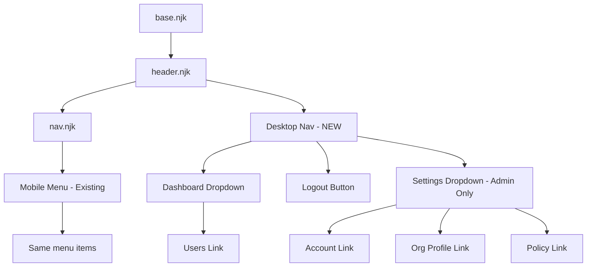

# Admin Dashboard Navigation Redesign - Design Document

## Overview

This design document covers the modernization of the admin dashboard navigation from a desktop hamburger menu to a standard top header navigation with dropdown menus. The redesign maintains mobile hamburger navigation (768px breakpoint) while providing desktop users with always-visible menu structure. Additionally, this includes the complete removal of the Key Generation feature from frontend and backend.

## Design Summary (Meta)

```yaml
design_type: "refactoring"
risk_level: "medium"
complexity_level: "medium"
complexity_rationale: "(1) Requirements involve coordinated frontend template, CSS, and JavaScript changes with backend route removal. (2) Responsive breakpoint handling and accessibility constraints require careful state management across mobile/desktop views."
main_constraints:
  - "768px breakpoint for mobile/desktop transition"
  - "Admin role-based visibility for Settings menu"
  - "Backward compatibility with existing auth flow"
  - "Full removal of Key Generation feature (frontend and backend)"
biggest_risks:
  - "CSS cascade issues between mobile hamburger and desktop header styles"
  - "JavaScript event handler conflicts during menu transitions"
  - "Accessibility regression for keyboard navigation"
unknowns:
  - "User preference for click vs hover dropdown behavior"
  - "Performance impact of additional CSS for desktop navigation"
```

## Background and Context

### Prerequisite ADRs

- None (no existing ADRs in this project)
- This design establishes the navigation pattern for future admin features

### Agreement Checklist

#### Scope
- [x] Replace desktop hamburger menu with top header navigation
- [x] Implement "Dashboard" with "Users" dropdown
- [x] Implement "Settings" dropdown (Account, Org Profile, Policy) - admin only
- [x] Add "Logout" button to top right
- [x] Remove Key Generation feature completely (frontend nav, page, backend routes)
- [x] Maintain hamburger menu for mobile (768px breakpoint)

#### Non-Scope (Explicitly not changing)
- [x] Authentication flow (Clerk.js integration)
- [x] Public page navigation (landing, pricing, login)
- [x] Other backend API routes (except key-generation)
- [x] Dashboard content and data visualization
- [x] Existing URL structure for pages (except key-generation removal)

#### Constraints
- [x] Parallel operation: No (breaking change for desktop navigation)
- [x] Backward compatibility: Yes (mobile behavior preserved)
- [x] Performance measurement: Not required (CSS/JS only)

#### Applicable Standards
- [x] Nunjucks templating patterns `[explicit]` - Source: `views/layouts/base.njk`, `views/partials/*.njk`
- [x] CSS class naming conventions `[implicit]` - Evidence: `public/dashboard.css` (kebab-case)
- [x] Event handler patterns `[implicit]` - Evidence: `public/nav.js` (IIFE, addEventListener)
- [x] 768px mobile breakpoint `[explicit]` - Source: `public/dashboard.css:522,1313`

### Problem to Solve

The current admin dashboard uses a hamburger menu on all screen sizes, including desktop. This is a suboptimal user experience because:

1. Desktop users have ample screen real estate that goes unused
2. Key navigation items require an extra click to access
3. The hamburger pattern is primarily intended for mobile space constraints
4. Modern admin dashboards typically show primary navigation in a visible top header

### Current Challenges

1. **Navigation Discovery**: Users must click hamburger to see available menu options
2. **Menu Structure**: Current flat list does not convey hierarchy (Dashboard vs Settings)
3. **Key Generation Deprecation**: Feature is being removed and must be cleaned up
4. **CSS Complexity**: Current hamburger styles are applied universally

### Requirements

#### Functional Requirements

1. Desktop (>768px): Display horizontal top header navigation with:
   - "Dashboard" label with "Users" as dropdown item
   - "Settings" label with dropdown items (Account, Org Profile, Policy) - visible to admins only
   - "Logout" button positioned at top right

2. Mobile (<=768px): Retain existing hamburger menu behavior

3. Remove Key Generation feature entirely:
   - Remove nav link from menu
   - Delete `views/pages/key-generation.njk`
   - Remove `POST /:orgSlug/key-generation` route from `src/routes/policy.ts`
   - Remove `GET /:orgSlug/key-generation` route from `src/server.ts`
   - Delete `public/key-generation.js`

#### Non-Functional Requirements

- **Performance**: Navigation CSS should not add significant render time
- **Accessibility**: Keyboard navigation support for dropdown menus (Tab, Enter, Escape)
- **Maintainability**: Clear separation between mobile and desktop navigation styles

## Acceptance Criteria (AC) - EARS Format

### Desktop Navigation Display (>768px)

- [ ] **When** viewport width exceeds 768px, the system shall display a horizontal top header navigation bar
- [ ] The system shall display "Dashboard" as the first top-level menu item
- [ ] **When** user hovers or clicks on "Dashboard", the system shall display a dropdown containing "Users" link
- [ ] **If** user is an admin, **then** the system shall display "Settings" menu item
- [ ] **When** user hovers or clicks on "Settings", the system shall display dropdown with "Account", "Org Profile", "Policy" items
- [ ] The system shall display "Logout" button at the top right of the header
- [ ] **When** viewport width exceeds 768px, the system shall hide the hamburger button

### Mobile Navigation (<=768px)

- [ ] **When** viewport width is 768px or less, the system shall display hamburger button
- [ ] **When** user clicks hamburger button on mobile, the system shall display the slide-out navigation menu
- [ ] **While** mobile menu is open, the system shall display the same menu items as desktop (Dashboard, Users, Settings dropdowns)
- [ ] **When** user clicks outside the mobile menu, the system shall close the menu

### Dropdown Interactions

- [ ] **When** user clicks dropdown trigger, the system shall toggle dropdown visibility
- [ ] **When** user presses Escape key while dropdown is open, the system shall close the dropdown
- [ ] **When** user clicks a dropdown item, the system shall navigate to the target page and close the dropdown
- [ ] The system shall provide visible focus indicator for keyboard navigation

### Admin Role Visibility

- [ ] **If** user role is not "admin", **then** the system shall hide the Settings menu entirely
- [ ] **While** auth check is pending, the system shall hide Settings menu (defensive default)

### Key Generation Removal

- [ ] The system shall not display "Key Generation" in any navigation menu
- [ ] **When** user navigates to `/:orgSlug/key-generation`, the system shall return 404
- [ ] **When** POST request is made to `/:orgSlug/key-generation`, the system shall return 404

### Logout Functionality

- [ ] **When** user clicks Logout button, the system shall sign out via Clerk and redirect to landing page

## Existing Codebase Analysis

### Implementation Path Mapping

| Type | Path | Description |
|------|------|-------------|
| Existing | `views/partials/header.njk` | Header template with hamburger button and conditional public/org nav |
| Existing | `views/partials/nav.njk` | Navigation menu structure with Settings submenu |
| Existing | `public/dashboard.css` | All navigation styles (hamburger, nav links, Settings submenu) |
| Existing | `public/nav.js` | Hamburger toggle, Settings collapse, link handlers |
| Delete | `views/pages/key-generation.njk` | Key generation page template |
| Delete | `public/key-generation.js` | Key generation client-side logic |
| Modify | `src/routes/policy.ts` | Contains `POST /:orgSlug/key-generation` route |
| Modify | `src/server.ts` | Contains `GET /:orgSlug/key-generation` route |

### Integration Points

- **Integration Target**: Clerk.js authentication
- **Invocation Method**: `window.PromptLineAuth.initClerk()`, role check via `/me` endpoint
- **Impact**: None - auth flow unchanged, only nav display logic modified

### Code Inspection Evidence

| File/Function | Relevance |
|---------------|-----------|
| `views/partials/header.njk:5-9` | Hamburger button conditional rendering |
| `views/partials/header.njk:44-48` | Nav wrapper inclusion for org pages |
| `views/partials/nav.njk:10-24` | Full menu structure with Settings submenu |
| `public/dashboard.css:56-77` | Hamburger button styles |
| `public/dashboard.css:78-95` | Nav wrapper overlay styles (mobile) |
| `public/dashboard.css:98-109` | Main nav panel styles (mobile drawer) |
| `public/dashboard.css:169-208` | Settings submenu toggle and collapse |
| `public/dashboard.css:1351-1360` | Desktop public nav visibility |
| `public/nav.js:12-16` | Hamburger click handler |
| `public/nav.js:27-38` | Settings toggle handler |
| `src/server.ts:177-183` | Key generation GET route |
| `src/routes/policy.ts:113-149` | Key generation POST route |

### Similar Component Search

- **Landing page navigation**: `public/dashboard.css:919-961` has `.public-nav` and `.public-nav-links` styles
- **Decision**: Create new admin-specific desktop navigation (NOT matching landing page exactly per requirements)
- **Rationale**: Admin navigation needs dropdown functionality and role-based visibility not present in public nav

## Design

### Change Impact Map

```yaml
Change Target: Admin dashboard navigation
Direct Impact:
  - views/partials/header.njk (add desktop nav structure)
  - views/partials/nav.njk (restructure menu hierarchy)
  - public/dashboard.css (add desktop nav styles, media queries)
  - public/nav.js (add desktop dropdown handlers)
  - src/routes/policy.ts (remove key-generation POST)
  - src/server.ts (remove key-generation GET)
Indirect Impact:
  - All admin pages using header partial (dashboard, users, user-detail, policy)
No Ripple Effect:
  - Public pages (landing, pricing, login)
  - API endpoints (ingest, summary, me, users, policy config)
  - Authentication flow
  - Database schema
```

### Architecture Overview

```
+----------------------------------------------------------+
|                    Browser Viewport                       |
+----------------------------------------------------------+
|                                                          |
|  Desktop (>768px):                                       |
|  +------------------------------------------------------+|
|  | [Brand]  Dashboard v  Settings v        [Logout]     ||
|  |            +-------+   +----------+                  ||
|  |            | Users |   | Account  |                  ||
|  |            +-------+   | Org Prof.|                  ||
|  |                        | Policy   |                  ||
|  |                        +----------+                  ||
|  +------------------------------------------------------+|
|                                                          |
|  Mobile (<=768px):                                       |
|  +------------------------------------------------------+|
|  | [Hamburger]  [Brand]                                 ||
|  +------------------------------------------------------+|
|  | Slide-out menu (existing behavior)                   ||
|  +------------------------------------------------------+|
|                                                          |
+----------------------------------------------------------+
```

### Data Flow

```
Page Load
    |
    v
[header.njk renders] --> [nav.njk includes menu structure]
    |
    v
[CSS applies] --> Desktop: show top nav, hide hamburger
              --> Mobile: show hamburger, hide top nav
    |
    v
[nav.js initializes] --> Desktop: setup dropdown handlers
                     --> Mobile: setup hamburger toggle
    |
    v
[Auth check via /me] --> admin role? --> Show Settings dropdown
                     --> non-admin? --> Hide Settings dropdown
```

### Component Hierarchy Diagram



### Integration Points List

| Integration Point | Location | Old Implementation | New Implementation | Switching Method |
|-------------------|----------|-------------------|-------------------|------------------|
| Desktop navigation | `header.njk` | Hamburger for all | Top header bar | Media query |
| Dropdown toggle | `nav.js` | Settings collapse only | All dropdowns | Event delegation |
| Admin visibility | `nav.js` | Settings li toggle | Desktop dropdown + mobile | Class toggle |

### Main Components

#### Component 1: Desktop Navigation Bar

- **Responsibility**: Display horizontal navigation for screens >768px
- **Interface**:
  - HTML: New `<nav class="admin-nav-desktop">` in header.njk
  - CSS: `.admin-nav-desktop`, `.admin-dropdown`, `.admin-dropdown-menu`
- **Dependencies**: Conditional on `orgSlug` context variable

#### Component 2: Dropdown Menu

- **Responsibility**: Show/hide nested menu items on interaction
- **Interface**:
  - HTML: `<div class="admin-dropdown">` with `<button>` trigger and `<ul class="admin-dropdown-menu">`
  - JS: Click to toggle, Escape to close, aria-expanded state
- **Dependencies**: Parent navigation component

#### Component 3: Mobile Navigation (Existing)

- **Responsibility**: Hamburger-triggered slide-out menu for screens <=768px
- **Interface**: Existing `.hamburger-btn`, `.header-nav-wrapper`, `.main-nav`
- **Dependencies**: No changes, only hidden at >768px

### CSS Architecture

```css
/* New classes for desktop navigation */
.admin-nav-desktop           /* Container for desktop horizontal nav */
.admin-nav-list              /* Horizontal list of nav items */
.admin-nav-item              /* Individual nav item */
.admin-dropdown              /* Dropdown container */
.admin-dropdown-trigger      /* Clickable dropdown header */
.admin-dropdown-menu         /* Hidden dropdown list */
.admin-dropdown-menu.is-open /* Visible dropdown state */
.admin-nav-logout            /* Right-aligned logout button */

/* Media query structure */
@media (min-width: 769px) {
  /* Show desktop nav, hide hamburger */
  .admin-nav-desktop { display: flex; }
  .hamburger-btn { display: none; }
  .header-nav-wrapper { display: none; } /* Hide mobile overlay */
}

@media (max-width: 768px) {
  /* Hide desktop nav, show hamburger */
  .admin-nav-desktop { display: none; }
  .hamburger-btn { display: flex; }
}
```

### Data Contract

#### Nav Context Variables

```yaml
Input:
  Type: Nunjucks template context
  Preconditions:
    - orgSlug: string (present for org pages, null for public)
    - showUserControls: boolean
    - isPlatformAdmin: boolean (optional)
  Validation: Server-side in route handlers

Output:
  Type: Rendered HTML
  Guarantees:
    - Desktop nav visible when orgSlug present and viewport >768px
    - Mobile hamburger visible when viewport <=768px
    - Settings hidden when user role !== 'admin'
  On Error: Graceful degradation (show hamburger only)
```

### State Transitions

```yaml
State Definition:
  - Desktop Dropdown Closed: Default state, aria-expanded="false"
  - Desktop Dropdown Open: After click, aria-expanded="true"
  - Mobile Menu Closed: Default state, no .menu-open class
  - Mobile Menu Open: After hamburger click, .menu-open class present

State Transitions:
  Desktop Dropdown Closed --> Click trigger --> Desktop Dropdown Open
  Desktop Dropdown Open --> Click trigger/Escape/Click outside --> Desktop Dropdown Closed
  Mobile Menu Closed --> Click hamburger --> Mobile Menu Open
  Mobile Menu Open --> Click hamburger/Escape/Click outside/Nav item --> Mobile Menu Closed

System Invariants:
  - Only one dropdown can be open at a time (desktop)
  - Mobile menu and desktop nav are mutually exclusive based on viewport
  - Settings visibility is always controlled by admin role check
```

### Error Handling

- **Auth failure**: Settings menu hidden by default (defensive), no explicit error
- **JS not loaded**: Desktop dropdowns fall back to direct links (progressive enhancement)
- **CSS not loaded**: Hamburger remains visible as fallback

### Logging and Monitoring

- No additional logging required (client-side navigation)
- Existing Clerk auth logging captures login/logout events

## Implementation Plan

### Implementation Approach

**Selected Approach**: Horizontal Slice (Foundation-driven)
**Selection Reason**: CSS media queries and desktop navigation styles must be in place before JavaScript handlers can be tested. Template changes depend on CSS classes being defined. Mobile functionality must be preserved throughout.

### Technical Dependencies and Implementation Order

#### Required Implementation Order

1. **Phase 1: CSS Foundation**
   - Technical Reason: CSS classes must exist before HTML uses them
   - Add desktop navigation styles to `public/dashboard.css`
   - Add media queries for 768px breakpoint
   - Define dropdown states and transitions

2. **Phase 2: Template Structure**
   - Technical Reason: HTML structure depends on CSS classes from Phase 1
   - Modify `views/partials/header.njk` to add desktop nav
   - Restructure `views/partials/nav.njk` for new hierarchy
   - Remove Key Generation nav link

3. **Phase 3: JavaScript Handlers**
   - Technical Reason: Event handlers need DOM elements from Phase 2
   - Update `public/nav.js` with desktop dropdown handlers
   - Ensure mobile handlers still work
   - Remove Key Generation link handler

4. **Phase 4: Backend Cleanup**
   - Technical Reason: Can be done independently but logically last
   - Remove `GET /:orgSlug/key-generation` from `src/server.ts`
   - Remove `POST /:orgSlug/key-generation` from `src/routes/policy.ts`
   - Delete `views/pages/key-generation.njk`
   - Delete `public/key-generation.js`

### Integration Points

**Integration Point 1: CSS + Template**
- Components: `dashboard.css` classes -> `header.njk` / `nav.njk` elements
- Verification: Visual inspection at different viewport widths

**Integration Point 2: Template + JavaScript**
- Components: DOM elements -> `nav.js` event handlers
- Verification: Click dropdowns, verify open/close behavior

**Integration Point 3: Auth + Navigation Display**
- Components: `/me` API -> admin role check -> Settings visibility
- Verification: Login as admin vs non-admin, verify Settings appears/hidden

### Migration Strategy

- No data migration required
- Breaking change for desktop UX (intentional improvement)
- Mobile experience unchanged (no migration needed)

## Test Strategy

### Basic Test Design Policy

Test cases derived from acceptance criteria focus on browser-observable behavior. Testing should be done manually in development environment due to Nunjucks/static file architecture.

### Manual Test Checklist

| AC Reference | Test Case | Expected Result |
|--------------|-----------|-----------------|
| Desktop Nav Display | Resize to >768px | Top header nav visible, hamburger hidden |
| Dashboard Dropdown | Click "Dashboard" | Dropdown shows "Users" link |
| Settings Dropdown | Click "Settings" as admin | Dropdown shows Account, Org Profile, Policy |
| Settings Hidden | Login as non-admin | Settings menu not visible |
| Mobile Hamburger | Resize to 768px or less | Hamburger visible, top nav hidden |
| Mobile Menu | Click hamburger | Slide-out menu appears |
| Escape to Close | Open dropdown, press Escape | Dropdown closes |
| Key Gen Removed | Navigate to `/:orgSlug/key-generation` | 404 response |
| Logout | Click Logout | Redirect to landing page |

### Accessibility Testing

- [ ] Tab through desktop nav items
- [ ] Enter to open dropdown
- [ ] Arrow keys within dropdown
- [ ] Escape to close
- [ ] Screen reader announces dropdown state (aria-expanded)

### Responsive Testing

Test at these viewport widths:
- 320px (mobile small)
- 768px (breakpoint boundary)
- 769px (desktop threshold)
- 1024px (desktop standard)
- 1440px (desktop large)

## Security Considerations

- **Admin visibility**: Settings menu hidden client-side is defense in depth; backend routes still require `requireOrgAdmin` middleware
- **Key Generation removal**: Deleting route handlers prevents API access even if nav link somehow persists
- **No new auth flows**: Existing Clerk integration unchanged

## Future Extensibility

- Additional top-level menu items can be added to `.admin-nav-list`
- New dropdown items follow same pattern as Settings submenu
- Mobile menu structure mirrors desktop for consistency

## Alternative Solutions

### Alternative 1: CSS-Only Dropdowns

- **Overview**: Use `:hover` and `:focus-within` for dropdowns without JavaScript
- **Advantages**: Simpler implementation, no JS dependencies
- **Disadvantages**: Less control over behavior, accessibility challenges
- **Reason for Rejection**: Click-to-toggle is more accessible and aligns with mobile touch behavior

### Alternative 2: Reuse Public Nav Pattern

- **Overview**: Adapt `.public-nav-links` for admin dashboard
- **Advantages**: Code reuse, visual consistency with landing page
- **Disadvantages**: Public nav lacks dropdowns and role-based visibility
- **Reason for Rejection**: Requirements specify admin-specific design, not matching landing page

## Risks and Mitigation

| Risk | Impact | Probability | Mitigation |
|------|--------|-------------|------------|
| CSS cascade conflicts | Medium | Medium | Use specific `.admin-` prefixed classes |
| Mobile regression | High | Low | Test mobile at each phase, preserve existing classes |
| Admin check timing | Medium | Low | Default to hidden, reveal only after role confirmed |
| Keyboard navigation gaps | Medium | Medium | Follow WCAG guidelines, test with screen reader |

## References

- [W3Schools - Responsive Top Navigation Menu](https://www.w3schools.com/howto/howto_js_topnav_responsive.asp) - Pattern reference for responsive navigation
- [Modern CSS - CSS-Only Accessible Dropdown Navigation](https://moderncss.dev/css-only-accessible-dropdown-navigation-menu/) - Accessibility patterns
- [Level Access - Accessible Navigation Menus](https://www.levelaccess.com/blog/accessible-navigation-menus-pitfalls-and-best-practices/) - ARIA implementation guidance
- [Interaction Design Foundation - Hamburger Menu UX](https://www.interaction-design.org/literature/article/hamburger-menu-ux) - When to use hamburger vs visible nav
- [WebAIM - Keyboard Accessibility](https://webaim.org/techniques/keyboard/) - Keyboard navigation requirements

## Update History

| Date | Version | Changes | Author |
|------|---------|---------|--------|
| 2026-02-04 | 1.0 | Initial version | Design Specialist |
