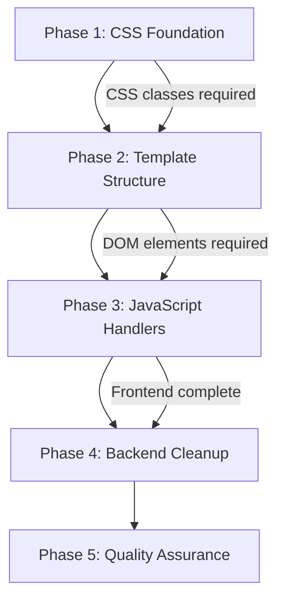
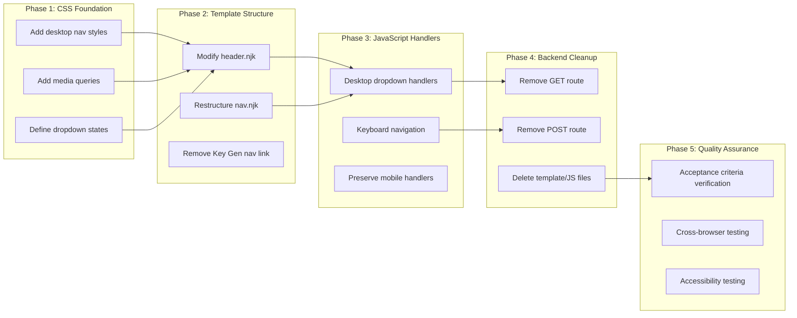

# Work Plan: Admin Dashboard Navigation Redesign

Created Date: 2026-02-04
Type: refactor
Estimated Duration: 2-3 days
Estimated Impact: 8 files (5 modifications, 3 deletions)
Related Issue/PR: N/A

## Related Documents
- Design Doc: [docs/design/admin-dashboard-navigation-redesign-design.md](/docs/design/admin-dashboard-navigation-redesign-design.md)
- ADR: None (no existing ADRs in this project)
- PRD: None

## Objective

Replace the desktop hamburger menu with a modern top header navigation featuring dropdown menus (Dashboard > Users, Settings > Account/Org Profile/Policy) while preserving mobile hamburger navigation at the 768px breakpoint. Additionally, complete removal of the deprecated Key Generation feature from both frontend and backend.

## Background

The current admin dashboard uses a hamburger menu on all screen sizes, which is suboptimal for desktop users who have ample screen real estate. This change modernizes the navigation UX by:
1. Showing always-visible top navigation on desktop
2. Organizing menu items into logical dropdown groups
3. Removing the deprecated Key Generation feature entirely
4. Maintaining mobile-friendly hamburger navigation

## Phase Structure Diagram



## Task Dependency Diagram



## Risks and Countermeasures

### Technical Risks

- **Risk**: CSS cascade conflicts between mobile hamburger and desktop header styles
  - **Impact**: Medium - could break navigation on one or both viewport sizes
  - **Countermeasure**: Use specific `.admin-` prefixed classes to avoid cascade issues; test at each phase

- **Risk**: JavaScript event handler conflicts during menu transitions
  - **Impact**: Medium - dropdowns may not function correctly
  - **Countermeasure**: Use event delegation pattern; verify handlers work at both breakpoints

- **Risk**: Accessibility regression for keyboard navigation
  - **Impact**: Medium - non-compliant with WCAG guidelines
  - **Countermeasure**: Follow WCAG guidelines; implement aria-expanded; test with Tab/Enter/Escape

- **Risk**: Mobile navigation regression
  - **Impact**: High - existing mobile functionality broken
  - **Countermeasure**: Preserve existing CSS classes; test mobile behavior at each phase

### Schedule Risks

- **Risk**: Unexpected complexity in CSS media query interactions
  - **Impact**: Could extend Phase 1 duration
  - **Countermeasure**: Start with simple media queries; iterate based on testing

## Implementation Phases

### Phase 1: CSS Foundation (Estimated commits: 1-2)
**Purpose**: Establish CSS infrastructure for desktop navigation

**Dependency**: None (starting phase)

#### Tasks
- [x] **Confirm skill constraints**: Verify Design Doc specifications and implementation approach
- [x] Add desktop navigation container styles (`.admin-nav-desktop`) to `public/dashboard.css`
- [x] Add horizontal nav list styles (`.admin-nav-list`, `.admin-nav-item`)
- [x] Add dropdown component styles (`.admin-dropdown`, `.admin-dropdown-trigger`, `.admin-dropdown-menu`)
- [x] Add dropdown state styles (`.is-open` modifier)
- [x] Add logout button positioning styles (`.admin-nav-logout`)
- [x] Add media query for desktop (min-width: 769px): show desktop nav, hide hamburger
- [x] Add media query for mobile (max-width: 768px): hide desktop nav, show hamburger
- [ ] Quality check: CSS linting and format verification

#### Files Modified
| File | Change Type | Description |
|------|-------------|-------------|
| `public/dashboard.css` | Modify | Add ~80-100 lines of desktop navigation styles |

#### Phase Completion Criteria
- [ ] All `.admin-*` CSS classes defined
- [ ] Media queries correctly toggle visibility at 768px/769px boundary
- [ ] CSS passes lint checks
- [ ] No changes to existing hamburger styles (mobile preserved)

#### Operational Verification Procedures
1. Open admin dashboard in browser at width >768px
2. Inspect elements to verify `.admin-nav-desktop` styles are applied (even if no HTML yet)
3. Resize to <=768px and verify hamburger button styles unchanged
4. Verify no CSS errors in browser console

---

### Phase 2: Template Structure (Estimated commits: 1-2)
**Purpose**: Implement HTML structure for desktop navigation using CSS classes from Phase 1

**Dependency**: Phase 1 complete (CSS classes must exist)

#### Tasks
- [x] Modify `views/partials/header.njk` to add desktop navigation structure
  - [x] Add `<nav class="admin-nav-desktop">` element
  - [x] Add Dashboard dropdown structure with Users link
  - [x] Add Settings dropdown structure (admin-only with conditional)
  - [x] Add Logout button positioned right
- [x] Restructure `views/partials/nav.njk` for updated menu hierarchy
  - [x] Ensure mobile menu structure mirrors desktop (Account moved into Settings submenu)
- [x] Remove Key Generation nav link from `views/partials/nav.njk`
- [ ] Quality check: Validate Nunjucks template syntax

#### Files Modified
| File | Change Type | Description |
|------|-------------|-------------|
| `views/partials/header.njk` | Modify | Add desktop nav HTML structure |
| `views/partials/nav.njk` | Modify | Remove Key Gen link, adjust hierarchy |

#### Phase Completion Criteria
- [ ] Desktop navigation HTML renders correctly at >768px viewport
- [ ] Hamburger hidden on desktop, visible on mobile
- [ ] Key Generation link no longer appears in any menu
- [ ] Settings menu structure includes Account, Org Profile, Policy
- [ ] No Nunjucks template errors

#### Operational Verification Procedures
1. Start development server: `npm run dev`
2. Navigate to admin dashboard (logged in as admin)
3. Resize browser to >768px: verify top header nav visible
4. Verify Dashboard dropdown shows "Users" link
5. Verify Settings dropdown shows Account, Org Profile, Policy links
6. Verify Logout button positioned at top right
7. Resize to <=768px: verify hamburger appears, top nav hidden
8. Click hamburger: verify mobile menu works
9. Search for "key-generation" in nav template: should not exist

---

### Phase 3: JavaScript Handlers (Estimated commits: 1-2)
**Purpose**: Implement interactive behavior for desktop dropdown menus

**Dependency**: Phase 2 complete (DOM elements must exist for event binding)

#### Tasks
- [x] Update `public/nav.js` with desktop dropdown click handlers
  - [x] Toggle dropdown visibility on trigger click
  - [x] Close dropdown when clicking outside
  - [x] Close other dropdowns when opening a new one
- [x] Implement keyboard navigation support
  - [x] Tab navigation through menu items
  - [x] Enter key to open dropdown
  - [x] Escape key to close dropdown
  - [x] Maintain aria-expanded attribute state
- [ ] Ensure mobile hamburger handlers preserved and functional
- [x] Remove any Key Generation link handlers (if present)
- [ ] Quality check: JavaScript linting

#### Files Modified
| File | Change Type | Description |
|------|-------------|-------------|
| `public/nav.js` | Modify | Add dropdown handlers, keyboard support |

#### Phase Completion Criteria
- [ ] Desktop dropdown toggles on click
- [ ] Only one dropdown open at a time
- [ ] Escape key closes open dropdown
- [ ] aria-expanded updates correctly
- [ ] Tab navigation works through all menu items
- [ ] Mobile hamburger toggle still functional
- [ ] No JavaScript errors in console

#### Operational Verification Procedures
1. Desktop viewport (>768px):
   - Click "Dashboard" - verify dropdown opens, shows Users
   - Click "Settings" - verify Dashboard dropdown closes, Settings opens
   - Press Escape - verify Settings dropdown closes
   - Tab through navigation - verify focus moves correctly
   - Click outside dropdown - verify it closes
2. Mobile viewport (<=768px):
   - Click hamburger - verify menu slides out
   - Verify menu items functional
   - Click hamburger again - verify menu closes
3. Admin role check:
   - Login as admin - verify Settings visible
   - Login as non-admin - verify Settings hidden
4. Browser console - verify no JavaScript errors

---

### Phase 4: Backend Cleanup (Estimated commits: 1-2)
**Purpose**: Remove Key Generation feature from backend routes and delete unused files

**Dependency**: Phase 3 complete (frontend no longer references Key Generation)

#### Tasks
- [x] Remove `GET /:orgSlug/key-generation` route from `src/server.ts`
- [x] Remove `POST /:orgSlug/key-generation` route from `src/routes/policy.ts`
- [x] Delete `views/pages/key-generation.njk` template file
- [x] Delete `public/key-generation.js` client script
- [x] Quality check: TypeScript compilation, lint check
- [ ] Verify 404 response for key-generation routes

#### Files Modified
| File | Change Type | Description |
|------|-------------|-------------|
| `src/server.ts` | Modify | Remove GET route for key-generation |
| `src/routes/policy.ts` | Modify | Remove POST route for key-generation |
| `views/pages/key-generation.njk` | Delete | Remove template file |
| `public/key-generation.js` | Delete | Remove client script |

#### Phase Completion Criteria
- [x] TypeScript compiles without errors
- [ ] Server starts successfully
- [ ] GET `/:orgSlug/key-generation` returns 404
- [ ] POST `/:orgSlug/key-generation` returns 404
- [x] No references to key-generation in codebase
- [x] Lint checks pass

#### Operational Verification Procedures
1. Run `npm run build` - verify no compilation errors
2. Run `npm run dev` - verify server starts
3. Navigate to `/{orgSlug}/key-generation` in browser - verify 404
4. Use curl/Postman: `POST /{orgSlug}/key-generation` - verify 404
5. Search codebase: `grep -r "key-generation"` - verify no active references

---

### Phase 5: Quality Assurance (Required) (Estimated commits: 1)
**Purpose**: Overall quality assurance, acceptance criteria verification, and Design Doc compliance

#### Tasks
- [ ] Verify all Design Doc acceptance criteria achieved (see checklist below)
- [ ] Cross-browser testing (Chrome, Firefox, Safari, Edge)
- [ ] Responsive testing at all specified viewports (320px, 768px, 769px, 1024px, 1440px)
- [ ] Accessibility testing (keyboard, screen reader, ARIA)
- [ ] Quality checks: TypeScript compilation, lint, format
- [ ] Execute all existing tests: `npm test`
- [ ] **Verify skill fidelity**: Confirm implementation matches Design Doc specifications

#### Acceptance Criteria Verification Checklist
From Design Doc - all must be verified:

**Desktop Navigation Display (>768px)**
- [ ] Horizontal top header navigation bar visible
- [ ] "Dashboard" displayed as first top-level menu item
- [ ] Dashboard dropdown shows "Users" link on hover/click
- [ ] "Settings" menu visible (if admin)
- [ ] Settings dropdown shows Account, Org Profile, Policy
- [ ] "Logout" button at top right
- [ ] Hamburger button hidden

**Mobile Navigation (<=768px)**
- [ ] Hamburger button visible
- [ ] Clicking hamburger shows slide-out menu
- [ ] Mobile menu contains same items as desktop
- [ ] Clicking outside mobile menu closes it

**Dropdown Interactions**
- [ ] Click dropdown trigger toggles visibility
- [ ] Escape key closes dropdown
- [ ] Clicking dropdown item navigates and closes dropdown
- [ ] Visible focus indicator for keyboard navigation

**Admin Role Visibility**
- [ ] Settings menu hidden for non-admin users
- [ ] Settings menu hidden while auth check pending

**Key Generation Removal**
- [ ] No "Key Generation" in any navigation menu
- [ ] GET `/:orgSlug/key-generation` returns 404
- [ ] POST `/:orgSlug/key-generation` returns 404

**Logout Functionality**
- [ ] Logout button triggers Clerk signout
- [ ] Redirects to landing page after logout

#### Manual Test Checklist (from Design Doc)
| AC Reference | Test Case | Status |
|--------------|-----------|--------|
| Desktop Nav Display | Resize to >768px | [ ] Pass |
| Dashboard Dropdown | Click "Dashboard" | [ ] Pass |
| Settings Dropdown | Click "Settings" as admin | [ ] Pass |
| Settings Hidden | Login as non-admin | [ ] Pass |
| Mobile Hamburger | Resize to 768px or less | [ ] Pass |
| Mobile Menu | Click hamburger | [ ] Pass |
| Escape to Close | Open dropdown, press Escape | [ ] Pass |
| Key Gen Removed | Navigate to `/:orgSlug/key-generation` | [ ] Pass |
| Logout | Click Logout | [ ] Pass |

#### Accessibility Testing Checklist
- [ ] Tab through desktop nav items - focus moves correctly
- [ ] Enter to open dropdown - works as expected
- [ ] Arrow keys within dropdown - navigates items
- [ ] Escape to close - closes dropdown
- [ ] Screen reader announces dropdown state (aria-expanded)

#### Responsive Testing Checklist
| Viewport | Desktop Nav | Mobile Hamburger | Status |
|----------|-------------|------------------|--------|
| 320px | Hidden | Visible | [ ] Pass |
| 768px | Hidden | Visible | [ ] Pass |
| 769px | Visible | Hidden | [ ] Pass |
| 1024px | Visible | Hidden | [ ] Pass |
| 1440px | Visible | Hidden | [ ] Pass |

#### Phase Completion Criteria
- [ ] All acceptance criteria verified and passing
- [ ] All manual tests passing
- [ ] All accessibility tests passing
- [ ] All responsive tests passing
- [ ] TypeScript compiles without errors
- [ ] Lint checks pass
- [ ] Existing tests pass (`npm test`)
- [ ] No regressions in other admin dashboard functionality

#### Operational Verification Procedures
1. Run full quality check suite:
   ```bash
   npm run build
   npm run lint
   npm test
   ```
2. Perform complete manual test checklist
3. Perform accessibility audit
4. Test on multiple browsers
5. Final review against Design Doc specifications

---

## Summary of Files Changed

| Phase | File | Change Type | Lines (Est.) |
|-------|------|-------------|--------------|
| 1 | `public/dashboard.css` | Modify | +80-100 |
| 2 | `views/partials/header.njk` | Modify | +30-40 |
| 2 | `views/partials/nav.njk` | Modify | +/-10 |
| 3 | `public/nav.js` | Modify | +50-70 |
| 4 | `src/server.ts` | Modify | -7 |
| 4 | `src/routes/policy.ts` | Modify | -37 |
| 4 | `views/pages/key-generation.njk` | Delete | -entire file |
| 4 | `public/key-generation.js` | Delete | -entire file |

## Quality Assurance Summary
- [ ] Implement staged quality checks at each phase
- [ ] TypeScript compilation successful
- [ ] All lint checks pass
- [ ] All format checks pass
- [ ] Build succeeds without errors
- [ ] All existing tests pass
- [ ] Manual acceptance criteria tests pass
- [ ] Accessibility requirements met

## Completion Criteria
- [ ] All phases completed
- [ ] Each phase's operational verification procedures executed
- [ ] Design Doc acceptance criteria satisfied (100%)
- [ ] Staged quality checks completed (zero errors)
- [ ] All tests pass
- [ ] No Key Generation references in codebase
- [ ] User review approval obtained

## Progress Tracking

### Phase 1: CSS Foundation
- Start: 2026-02-04
- Complete: (in progress)
- Notes: Task 01 complete - base desktop navigation CSS classes added (admin-nav-desktop, admin-nav-list, admin-nav-item, admin-dropdown, admin-dropdown-trigger, admin-dropdown-menu, admin-nav-logout). Task 02 pending for media queries and .is-open state.

### Phase 2: Template Structure
- Start: 2026-02-04
- Complete: (in progress)
- Notes: Task 03 complete - Desktop navigation HTML structure added to header.njk with Dashboard dropdown (Users link), Settings dropdown (Account, Org Profile, Policy links with is-hidden class), and Logout button. Proper ARIA attributes included.

### Phase 3: JavaScript Handlers
- Start: 2026-02-04
- Complete: (in progress)
- Notes: Task 05 complete - Desktop dropdown click handlers added (initDesktopDropdowns, closeAllDropdowns, initAdminSettingsVisibility). Key Generation link handler removed. Task 06 complete - Keyboard navigation support added (initDropdownKeyboardNav with Escape, Enter/Space, ArrowDown/ArrowUp, Tab handlers). Focus styles added to dashboard.css.

### Phase 4: Backend Cleanup
- Start: ____-__-__ __:__
- Complete: ____-__-__ __:__
- Notes:

### Phase 5: Quality Assurance
- Start: ____-__-__ __:__
- Complete: ____-__-__ __:__
- Notes:

## Notes

### CSS Class Reference (Phase 1)
```css
.admin-nav-desktop           /* Container for desktop horizontal nav */
.admin-nav-list              /* Horizontal list of nav items */
.admin-nav-item              /* Individual nav item */
.admin-dropdown              /* Dropdown container */
.admin-dropdown-trigger      /* Clickable dropdown header */
.admin-dropdown-menu         /* Hidden dropdown list */
.admin-dropdown-menu.is-open /* Visible dropdown state */
.admin-nav-logout            /* Right-aligned logout button */
```

### Media Query Breakpoints
- Mobile: `max-width: 768px`
- Desktop: `min-width: 769px`

### Key Files Reference
- CSS Styles: `public/dashboard.css`
- Header Template: `views/partials/header.njk`
- Navigation Template: `views/partials/nav.njk`
- JavaScript: `public/nav.js`
- Server Routes: `src/server.ts`, `src/routes/policy.ts`

### Design Doc Reference Points
- Architecture Overview: Design Doc lines 213-235
- CSS Architecture: Design Doc lines 310-334
- State Transitions: Design Doc lines 360-377
- Integration Points: Design Doc lines 428-439
